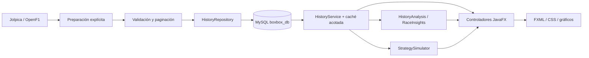
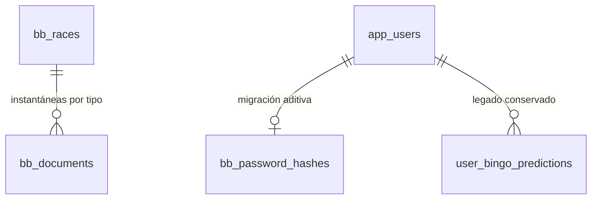

# Arquitectura de BoxBox

## Flujo de datos

La preparación es una acción separada y visible. Cambiar carrera, comparar,
narrar y simular consultan MySQL y no dependen de una llamada de red en vivo.

## Responsabilidades

- `model.history.RaceData`: modelos inmutables, sin JavaFX/JDBC.
- `Timing` y `HistoryParser`: conversión reproducible, ausencias explícitas.
- `HistoricalApiClient`: HTTP con timeout, identificación y paginación verificada;
  ritmo compartido de consultas y reintentos acotados ante 429/5xx.
- `HistoryImportService`: descargar, procesar y validar antes de persistir.
- `HistoryRepository`: SQL preparado, transacción, inserciones inmutables y SHA-256.
- `HistoryService`: fachada local y caché LRU de ocho carreras.
- `HistoryAnalysis`, `RaceInsights`, `StrategySimulator`: algoritmos puros reutilizables.
- `DemoArchive`: exportación/importación atribuida de observaciones públicas sin usuarios.
- `AuthenticationService` / `PasswordHasher`: autenticación y política criptográfica
  independientes de JavaFX; `AuthController` vincula el resultado con la sesión desktop.
- Controladores de vista: interacción, tareas de fondo, formato y gráficos.

## Modelo de archivo y relaciones

Los catálogos/CRUD existentes se conservan. `bb_races` normaliza la identidad
temporada/ronda y metadatos; `bb_documents` conserva respuestas procesadas de cada
proveedor como archivo de procedencia, no como una tabla de estadísticas fingidas.
Su LONGTEXT tiene CHECK JSON_VALID, FK al GP, clave compuesta por tipo, URL,
timestamp y hash. Se evita el reformateo automático del tipo JSON para verificar
el texto exacto almacenado. La API publicada de modelos está separada de ese formato.

Esta elección conserva campos desconocidos y permite reprocesar las fuentes,
evitando una migración destructiva de las tablas heredadas. El volumen de una
carrera se procesa en memoria. Consultas agregadas masivas y una proyección
relacional por vuelta serían una evolución futura, no una propiedad ya implementada.

## Importación y conservación

- Una descarga incompleta no se guarda.
- Los documentos existentes no se reemplazan, aunque la fuente cambie.
- La transacción añade calendario/documentos faltantes o revierte todo el lote.
- Las instantáneas muestran su antigüedad; no se afirma actualización en vivo.
- La edición manual heredada no se sincroniza ni se borra al preparar el archivo.
- No se ejecutan DDL desde la interfaz. La migración V001 es aditiva y administrativa.

## Preparación web futura

Los modelos y algoritmos no conocen controles JavaFX. Una futura capa HTTP puede
invocar los mismos servicios. No se incorporaron Spring Boot, React, una IA
generativa ni servicios de pago. Se mantuvieron JavaFX, JDBC, Gson y MySQL.
